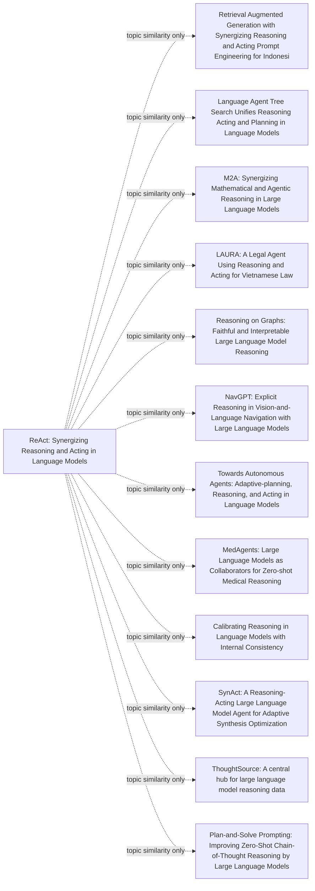

> 真实模型运行生成的完整分析；仅隐藏私有模型路由并省略原文摘录，分析文字未人工改写。研究结论仍需核查，来源缺口保留。

# ReAct: Synergizing Reasoning and Acting in Language Models

生成时间：2026-10-18T05:40:24.463Z · 模型：Harness configured route (redacted)/Harness selected model (redacted)
阅读范围：extracted-text（9/9 个文本片段）

论文来源：https://arxiv.org/abs/2210.03629v3

## 阅读与证据边界

- 文本抽取不保证公式、图表与双栏阅读顺序完整；重要结论需对照原文图表。
- 每类至多 12 篇，非系统综述；主题搜索不证明引用或技术继承关系。
- 程序只校验引用存在、短引与原文一致和结构完整；事实蕴含、产品可行性与图表解释仍需人工判断。

## 论文与技术解析

ReAct 将“思考—行动—观察”交错起来，让 LLM 在推理中调用外部工具，并用观察修正计划；论文在 HotpotQA、FEVER、ALFWorld、WebShop 上报告了混合结果，主要优势出现在交互决策任务，同时存在提示、上下文和可复现性限制。

### background

LLM 的链式推理与行动规划长期分开研究；知识密集任务易幻觉，交互任务有长程稀疏奖励。

### problem

如何让模型在推理中主动获取外部信息，并用观察修正计划，同时保持可解释轨迹。

### oneSentenceIdea

让模型交错生成 thought、action 和 observation，用行动 grounding 推理、用推理选择行动。

### mechanism

动作空间扩为 A∪L；thought 不改变环境；search/lookup/finish 等动作调用 Wikipedia 或环境；观察回填后继续。

### inputProcessOutput

输入为问题/声明/指令及少量示例；处理为多轮 Thought→Action→Observation；输出为最终答案、判断或环境动作序列。

### innovation

交错推理与行动、系统消融 Act/CoT、ReAct+CoT 组合及微调探索。

### experiments

HotpotQA、FEVER、ALFWorld、WebShop；PaLM-540B 提示，PaLM-8/62B 微调，另有 GPT-3 补充；报告 EM、准确率、成功率。

### conditions

依赖可调用工具、可解析动作格式、足够上下文示例；长程任务还需状态跟踪和失败恢复。

### limitations

提示下双技能学习有限；动作空间较弱；长示范超上下文；主模型不公开；微调需高质量人工数据；部分结论是基准内结果。

### value

提供了可审计的 Agent 循环范式，但收益强依赖任务、模型与工具质量。

### beginnerVersion

像边看地图边走路：先想下一步，再查/走，看到结果再改计划。类比失效处：模型的想法可能错，地图和工具也可能返回噪声。

### productManagerVersion

可交付能力是“可观察的思考—调用—观察”流程；需权限、超时、回退、成本与审计。它不是自动通用智能，须按任务验证。

### engineeringVersion

实现为轨迹状态机与工具网关：动作解析、观察截断、重试/回退、上下文预算、日志评测；可提示或微调。

### formulas

动作空间 Â=A∪L，L 为语言空间；thought∈L 不改变环境、不产生 observation；无统一目标函数，EM/成功率是评测指标；ReAct→CoT-SC 用 7/5 步阈值，CoT-SC→ReAct 用多数票少于 n/2 的启发式。

**论文事实 · 置信度 high**

论文针对推理与行动被分开研究的问题：CoT 易幻觉和错误传播，纯行动缺少前瞻规划；ReAct 让推理轨迹诱导、跟踪和更新行动计划，并借动作访问外部知识或环境。

依据：[P1.F1](#p1-f1)、[P1.F3](#p1-f3)、[P5.F3](#p5-f3)

含义与应用：核心价值是把外部观察纳入推理闭环，而不是仅生成更长的思维链。

验证与限制：对照论文中 CoT 幻觉案例与 ReAct 检索成功案例，并在同一模型、同一问题上复现。

**论文事实 · 置信度 high**

机制上，ReAct 把动作空间扩展为 A∪L；语言空间中的 thought 不改变环境、不产生观察，真正的工具动作才返回 observation，形成可解析的交错轨迹。

依据：[P1.F2](#p1-f2)、[P2.F1](#p2-f1)、[P6.F2](#p6-f2)、[P6.F4](#p6-f4)

含义与应用：工程实现需把 thought 与可执行 action 分开建模，并维护观察、超时和终止状态。

验证与限制：构造状态机解析 Thought/Action/Observation，检查非法动作、空观察和 Finish 的鲁棒性。

**论文事实 · 置信度 high**

实验结果并非全面领先：PaLM-540B 提示下，ReAct 在 FEVER 为 60.9 对 CoT 56.3，在 HotpotQA 为 27.4 对 CoT 29.4；ALFWorld 最佳 ReAct 成功率 71%，高于最佳 Act 45% 和 BUTLER 37%；摘要报告 WebShop 相对模仿/强化学习绝对提升 10%。

依据：[P2.F6](#p2-f6)、[P3.F5](#p3-f5)、[P1.F4](#p1-f4)、[P1.F5](#p1-f5)

含义与应用：技术适配依赖任务：知识问答可能不如强 CoT，长程交互决策更受益。

验证与限制：按任务类型分层复现，报告均值、方差、提示敏感性和成本，不只引用最佳试验。

**论文事实 · 置信度 high**

微调可改变小模型表现：用 3000 条正确轨迹微调后，PaLM-8B ReAct 超过所有 PaLM-62B 提示方法；但大动作空间需更多示范，可能超过上下文长度，主实验所用 PaLM 也未公开。

依据：[P3.F1](#p3-f1)、[P2.F5](#p2-f5)、[P4.F2](#p4-f2)、[P4.F5](#p4-f5)

含义与应用：提示版 ReAct 不是低成本即插即用；产品化应评估微调数据、工具可靠性和模型可得性。

验证与限制：用公开模型复现提示与微调两条路线，记录数据标注成本、上下文溢出率和失败模式。

## 第一性原理与主要次要矛盾

从目标看，ReAct 用外部观察降低内部知识不确定性；主要矛盾是“需要 grounding 的推理”与“需要推理指导的长程行动”互相依赖。它用交错轨迹改变权衡，但以 token、延迟、工具依赖和错误传播为代价，且在短程或强检索场景未必优于更简单方案。

### fundamentalGoal

在有限上下文与不可靠内部知识下，用最少外部观察得到可执行、可核验的决策。

### constraints

上下文长度、工具延迟与费用、动作空间可解析性、模型稳定性、权限与安全、标注数据成本。

### primaryContradiction

推理需要外部 grounding，行动又需要推理做选择与纠错；单靠 CoT 无观察，单靠 Act 缺前瞻。判断依据是论文中 CoT 幻觉/算术错误与 Act 在 ALFWorld 卡死的对照。

### secondaryContradictions

上下文预算与轨迹长度、检索失败与噪声观察、thought 忠实性、工具权限攻击面、微调数据质量；这些在主要矛盾缓解后更突出。

### existingSolution

CoT、Act、检索增强、模仿学习/强化学习、规则状态机；各有幻觉、盲目行动或工程成本问题。

### newMechanism

把语言 thought 纳入动作空间但不改变环境，真实 action 获取 observation，再回填上下文继续推理，形成交错闭环。

### costAndBoundary

代价是更多 token、延迟、工具依赖和提示工程；当任务短程、检索很强、模型已可靠或工具不可用时，收益可能不成立。

### newContradiction

更长轨迹增加溢出与错误传播；可解释轨迹不等于因果忠实；更强工具权限带来安全与责任边界。

### simplerAlternatives

纯 CoT、单次 RAG、Act/规则状态机、仅在低置信时回退 ReAct；先做成本—成功率对照，再决定是否采用复杂循环。

**推断 · 置信度 high**

根本目标是在有限上下文和不可靠参数知识下，以尽量少的外部调用获得可执行、可核验的决策；约束包括上下文长度、工具延迟/成本、动作空间、权限安全和模型解析稳定性。

依据：[P1.F1](#p1-f1)、[P2.F2](#p2-f2)、[P4.F2](#p4-f2)、[P4.F6](#p4-f6)

含义与应用：评估应同时看任务成功率、事实性、调用次数、延迟和失败可恢复性，而非只看答案分数。

验证与限制：建立成本—成功率曲线，比较不同调用预算和上下文长度下的表现。

**推断 · 置信度 high**

主要矛盾是推理与行动相互依赖：CoT 缺观察会幻觉，Act 缺推理会在长程任务中盲目或卡死；论文用 CoT 错误案例和 Act 在 ALFWorld 的重复失败支持这一点。

依据：[P1.F3](#p1-f3)、[P5.F3](#p5-f3)、[P8.F5](#p8-f5)、[P3.F5](#p3-f5)

含义与应用：交错机制只在“外部信息能纠正推理且推理能选择动作”的任务中占优。

验证与限制：在可屏蔽工具或屏蔽 thought 的 2×2 消融中测成功率与错误类型。

**推断 · 置信度 high**

新机制把部分内部推理替换为“思考—调用—观察”循环，用更多 token、延迟和工具依赖换取事实 grounding 与可审计性；ALFWorld 71% 对 Act 45% 是支持证据，但 HotpotQA 27.4 低于 CoT 29.4 说明权衡不总是正向。

依据：[P1.F2](#p1-f2)、[P3.F5](#p3-f5)、[P2.F6](#p2-f6)、[P2.F4](#p2-f4)

含义与应用：应按任务决定是否引入 ReAct，并保留纯 CoT/单次检索作为回退。

验证与限制：A/B 比较 ReAct、CoT、RAG 和规则状态机的成功率—成本帕累托前沿。

**推断 · 置信度 medium**

次要矛盾会随主要瓶颈改善而显现：轨迹变长带来上下文溢出和错误传播，检索动作弱会产生非信息性搜索，thought 可能不忠实，工具权限扩大攻击面；作者也指出大动作空间需更多示范且主模型不公开。

依据：[P4.F2](#p4-f2)、[P2.F2](#p2-f2)、[P4.F5](#p4-f5)、[P5.F4](#p5-f4)、[P4.F6](#p4-f6)

含义与应用：产品化必须加入观察压缩、动作校验、回滚、权限隔离和轨迹审计。

验证与限制：注入噪声观察、超时和恶意工具返回，测恢复率、越权率和人工接管成本。

**待验证方案 · 置信度 medium**

更简单替代包括纯 CoT、一次检索增强、Act/规则状态机，以及仅在低置信时回退 ReAct；这些在短程、工具稳定或强检索任务中可能更便宜，应先作为基线而非直接上复杂 Agent。

依据：[P2.F3](#p2-f3)、[P2.F6](#p2-f6)、[P2.F4](#p2-f4)

含义与应用：先做最小对照实验，避免把基准优势误当产品收益。

验证与限制：以相同模型和工具做四臂对照，成功阈值设为 ReAct 相对基线提升超过调用成本且无安全回退恶化。

## Agent 沙箱的关系与落地

ReAct 本身不是沙箱技术；作为研究方法可在受控工具环境中改造使用，对沙箱运行环境只有编排与可观测层面的间接启发，不能替代隔离、权限和资源控制。

### applicability

改造后适用：作为受控工具环境中的实验编排与观测方法，不是直接适用。

### relatedLayer

模型推理、规划、工具执行、状态/记忆、观测评测；不覆盖文件系统、网络、进程隔离与资源调度。

### traditionalApproach

把 CoT 与 Act 分开：先规划再执行，或固定脚本调用工具；失败后整段重跑。

### integrationChanges

在沙箱 API 前加轨迹器；工具白名单；步数与预算上限；中断、快照、回滚；人工编辑 thought 后分叉重跑。

### interfacesAndResources

LLM 推理 API；检索/文件/HTTP 工具适配器；轨迹存储；沙箱执行器；GPU 取决于模型部署，延迟主要来自多次调用。

### metrics

任务成功率、平均步数、工具错误率、越权拦截率、注入攻击成功率、P95 延迟、单任务成本、回放一致率。

### risks

幻觉动作、观察注入、循环不终止、工具副作用、非确定性复现难；论文未覆盖开放网络安全。

### horizon

2–4 周 PoC：单工具白名单、轨迹回放、20–50 个任务；周期为提案估计，证据不足。

**论文事实 · 置信度 high**

原文只在 Wikipedia API、ALFWorld、WebShop 等受控环境评估，未验证通用 Agent 沙箱；因此“用沙箱开展该研究”需改造成工具白名单加轨迹记录。

依据：[P2.F2](#p2-f2)、[P3.F4](#p3-f4)、[P4.F6](#p4-f6)

含义与应用：不能把论文结果外推为开放沙箱中的安全性和泛化性。

验证与限制：在受限文件/HTTP 工具沙箱中复现 20–50 个任务，记录越权与失败类型。

**推断 · 置信度 medium**

thought-action-observation 循环可映射到工具执行与状态记录，但论文动作是 search/lookup/finish 或环境命令，接入通用文件、网络、进程需额外适配。

依据：[P1.F1](#p1-f1)、[P2.F2](#p2-f2)、[P7.F5](#p7-f5)

含义与应用：适合做执行编排和可观测层，不是现成的沙箱运行时。

验证与限制：实现单工具适配器，比较固定脚本与 ReAct 循环的成功率和步数。

**推断 · 置信度 medium**

论文未评估进程隔离、资源调度、网络权限或提示注入；其边界仅是限制站点且动作空间无危险操作。因此“该技术改进沙箱运行环境”不成立于安全隔离，只是间接启发。

依据：[P4.F6](#p4-f6)

含义与应用：安全控制必须由独立策略层承担。

验证与限制：红队注入观察文本、越权工具调用和循环耗尽，测拦截率与误拦截率。

## 现有产品的新功能与能力

基于 ReAct 的“思考-行动-观察”可审计性，提出轨迹编辑重跑与执行前策略闸门两项产品能力；均为提案，论文只提供研究环境证据。

### technicalCapability

LLM 可交错生成推理与动作，并用观察更新计划；thought 不直接改变环境。

### productCapability

稳定交付需叠加轨迹存储、权限闸门、回放/分叉、预算与人工审批；论文未提供这些工程保障。

### userRole

Agent 开发者、SRE/安全管理员、业务审核员。

### scenario

受控工具型 Agent 的调试、上线与事故复盘，覆盖检索、只读文件和 HTTP。

### painPoint

失败难定位，只能重跑或改 prompt；越权与注入风险不可见。

### requirement

可审计、可中断、可回放、最小权限、成本可控。

### featureDesign

时间线展示 thought/action/observation；编辑 thought 后从该步分叉重跑；动作执行前按工具、参数、数据域做策略校验；超步数或成本自动暂停。

### implementation

SDK 包裹 LLM 与工具；事件日志；快照；策略引擎；回放器；MVP 先支持一个检索工具和一个只读文件工具。

### benefits

缩短定位时间、提高失败恢复率、降低越权副作用。

### metrics

首次定位时间、修复后成功率、人工编辑采纳率、越权拦截率、误拦截率、P95 延迟、单任务成本。

### cost

轨迹存储与回放开销、策略维护、额外 LLM 调用；需按任务设限额。

### risks

编辑 thought 可能引入错误；模型非确定性；策略过严降低完成率；观察内容可能含注入指令。

### priority

P0 做只读工具加策略闸门 MVP；P1 做轨迹编辑重跑；高副作用工具暂缓。

**论文事实 · 置信度 high**

论文示例中，人工删除幻觉句并添加提示可明显改变 ReAct 行为并完成任务；这支持“轨迹编辑重跑”设想，但不是产品验证。

依据：[P5.F4](#p5-f4)、[P5.F5](#p5-f5)

含义与应用：可把 thought 作为可检查、可编辑的控制面，降低只能改 prompt 或重训的成本。

验证与限制：原型中比较直接重跑与编辑后分叉重跑的定位时间和修复成功率。

**论文事实 · 置信度 high**

ReAct 将动作空间扩展为 A∪L，语言空间中的 thought 不直接影响外部环境，因此可设计“无副作用计划层”，在真实工具调用前加策略检查。

依据：[P1.F2](#p1-f2)

含义与应用：产品上可把推理与有副作用执行分离，但权限执行器需额外建设。

验证与限制：对文件写入、HTTP 请求做参数级策略校验，测越权拦截与误拦截。

**论文事实 · 置信度 high**

论文的组合回退采用 7/5 步启发式阈值，不是通用置信度路由；产品若自动切换策略必须按任务重新校准。

依据：[P2.F4](#p2-f4)

含义与应用：不能照搬阈值作为稳定产品逻辑。

验证与限制：用历史失败轨迹离线回放，比较固定阈值与学习型路由的成功率和成本。

## 新产品机会

以下为基于 ReAct 证据的产品设想，并非已有产品：核心是把可编辑、可审计的交错推理—行动轨迹做成检索核验工作台。

### name

TraceDesk（暂名）

### concept

可编辑、可审计的 ReAct 检索核验工作台；产品设想，非已有产品。

### users

法务、合规、尽调、情报分析研究员。

### scenario

多跳事实核验、来源冲突、检索失败后的改写与复核。

### painPoint

RAG 答案黑箱、引用难核、失败后只能重问。

### value

缩短证据核验时间，保留可审计轨迹与人工控制点。

### capabilities

技术能力：交错 thought/action；稳定产品能力：权限连接器、来源缓存、审计与回滚；用户功能：编辑 thought、重跑分支、导出备忘。

### mvp

只读公开网页/客户文档检索；轨迹面板；引用固定；人工批准；无外部写操作。

### businessHypothesis

按席位订阅，先小团队试点；交付可 SaaS 或私有化；模型与检索成本未验证。

### metrics

核验时间、引用准确率、无支撑断言率、编辑接受率、恢复率、P95 延迟、单任务成本。

### risks

提示脆弱、弱检索器、小模型难学双行为、轨迹看似合理但错误、隐私与越权。

### technologyNecessity

必要性待验证：普通 RAG 是基线；仅在需要多步改写与失败恢复时可能有优势。

### feasibilityStatus

原型可行、产品未验证；须与标准 RAG 对照。

**待验证方案 · 置信度 medium**

提出 TraceDesk：面向尽调、法务与情报研究员的证据核验工作台，用户提出可核查问题，系统展示计划、检索动作、来源与不确定性，允许编辑 thought 后重跑分支并导出带引用的备忘。

依据：[P1.F1](#p1-f1)、[P1.F3](#p1-f3)、[P5.F4](#p5-f4)、[P5.F5](#p5-f5)

含义与应用：产品价值在可审计与可纠错，不在替代专家；需验证用户是否真的使用轨迹。

验证与限制：5–8 名研究员对照标准 RAG；若核验时间不降或 thought 编辑率低于 10%，停止。

**推断 · 置信度 high**

技术能力、稳定产品能力、用户功能必须分层：交错 thought-action-observation 是论文能力；稳定交付需连接器权限、来源缓存、失败检测、审计日志与回滚；用户可操作的是编辑 thought、固定来源、批准或回滚。

依据：[P1.F1](#p1-f1)、[P2.F2](#p2-f2)、[P4.F2](#p4-f2)、[P5.F4](#p5-f4)

含义与应用：不能把论文提示效果直接当作产品可靠性。

验证与限制：灰盒故障注入：检索失败、过期来源、冲突证据；测恢复率与审计完整性。

**待验证方案 · 置信度 medium**

MVP 只做只读检索与人工批准，覆盖公开网页或客户文档，不自动下单、不写外部系统；优先级 P0 引用与审计，P1 编辑重跑，P2 多连接器。

依据：[P4.F6](#p4-f6)、[P2.F2](#p2-f2)、[P7.F2](#p7-f2)

含义与应用：低风险先验证审计价值，避免越权动作。

验证与限制：4 周试点，来源可追溯率须≥95%，否则不扩展；最便宜否证是 10 个任务对照标准 RAG。

**文献事实 · 置信度 medium**

外部摘要仅提供初步迁移信号：D1 报告 ReAct 在印尼开放域 QA 上 METEOR/BERTScore 约提升 2%，D4 将 ReAct 用于越南法律问答；这不足以证明本产品商业价值。

依据：[D1](#d1)、[D4](#d4)

含义与应用：可支持技术可迁移假设，不能替代用户体验与付费验证。

验证与限制：复现 D1 的对照设置，并在法律任务上测引用准确率与专家复核时间。

## 产品体验改进

体验优化是让用户看见并纠正检索决策，而不是只看最终答案；以下为待验证设计，不声称已取得提升。

### beforeJourney

提问→一次检索→答案加引用；失败或歧义不可见，用户重问或手工搜索。

### afterJourney

提问→计划→逐步检索→来源固定→按需展开轨迹→编辑 thought 或重跑→人工批准→导出备忘。

### usability

默认折叠轨迹，只突出计划、来源与不确定点，避免长日志淹没。

### efficiency

减少重问与复制，但多步调用增加延迟，需缓存与并行。

### reliability

检索失败可恢复；轨迹仍可能合理化错误，需来源校验与冲突提示。

### transparency

显示每步动作、观察、引用与未决问题。

### control

可编辑、重跑、回滚、批准；不可自动对外发布。

### trust

提供证据覆盖与置信提示，不承诺正确。

### automation

自动建议改写与下一步；低置信时暂停请求人工。

### metrics

核验时间、一次通过率、引用准确率、无支撑断言率、编辑接受率、恢复率、P95 延迟、成本。

### guardrails

只读沙箱、域名白名单、隐私脱敏、审计日志、人工批准、过度信任监测。

**推断 · 置信度 high**

优化前：标准 RAG 一次检索后给答案，检索失败或页面歧义时用户看不到原因，只能重问；ReAct 轨迹示例展示搜索失败后依据相似项改写、观察后改查。

依据：[P6.F2](#p6-f2)、[P6.F3](#p6-f3)、[P7.F2](#p7-f2)

含义与应用：可见的失败恢复可能减少重复提问与手工搜索。

验证与限制：对照实验记录重问次数、定位失败耗时与任务完成率。

**推断 · 置信度 medium**

优化后：轨迹面板按需展开 thought/action/observation，用户可删除幻觉句或加提示后重跑；论文示例称两处编辑使行为大幅改变并成功，但这不是产品 UX 验证。

依据：[P5.F4](#p5-f4)、[P5.F5](#p5-f5)

含义与应用：可编辑轨迹提供控制感，但编辑成本和理解负担需实测。

验证与限制：可用性测试：编辑接受率、恢复成功率、SUS 与完成时间。

**推断 · 置信度 high**

可解释不等于可信：ReAct 轨迹仍可能出现推理错误或标签歧义；界面应显示证据覆盖与未决问题，禁止把轨迹当正确性证明。

依据：[P9.F4](#p9-f4)、[P9.F6](#p9-f6)、[P1.F3](#p1-f3)

含义与应用：需防过度信任，透明性必须配合来源校验。

验证与限制：专家盲评答案与轨迹，测过度信任率与误判率。

**待验证方案 · 置信度 medium**

A/B：标准 RAG 对轨迹工作台；主指标为一次核验通过时间与无支撑断言率；护栏为 P95 延迟、成本、隐私违规与误拒率；模型分数不能自动视为体验提升。

依据：[P5.F4](#p5-f4)、[P2.F6](#p2-f6)、[P3.F5](#p3-f5)

含义与应用：只有时间或错误率改善且护栏不恶化才继续。

验证与限制：随机交叉试点，预注册阈值，至少 30 任务/人；若时间不降或过度信任上升则停止。

## 研究现状、参考文献与研究脉络

截至2026-10-18，基于OpenAlex主题检索（S2引用/参考接口失败，非系统综述），无法建立完整引用链。ReAct位于CoT与工具/环境行动之间；后续呈工具检索、树搜索规划、知识图谱、具身导航、训练融合与领域代理多条路线。D1/D4摘要明确采用或探索ReAct，其余多为主题相关，不能当作技术继承证据。

### retrievalDate

2026-10-18；OpenAlex主题检索，Semantic Scholar引用/参考接口失败，非系统综述。

### origins

CoT作纯推理基线；SayCan/Inner Monologue用LLM做机器人规划与环境反馈；ReAct将thought/action交错（P2.F3,P4.F3,P4.F4,P1.F1）。

### milestones

2022 ReAct；2023 LATS(D2)、RoG(D5)；2024 NavGPT(D6)、自纠正(D7)、MedAgents(D8)；2025 ReAct+RAG(D1)、LAURA(D4)；2026 M2A(D3)、SynAct(D10)。

### routes

工具检索问答、树搜索规划、KG grounding、具身导航、自纠正/多代理、训练融合、工程闭环；仅D1/D4摘要明确用ReAct。

### breakthroughs

推理轨迹与外部动作交错，使观察进入下一轮推理；原文报告优于Act/IL/RL且ReAct+CoT最佳（P1.F4,P1.F5）。

### currentState

ReAct成常见提示/代理范式，但后续多为应用扩展，缺统一成本、安全与复现比较；原主实验用非公开PaLM（P4.F5）。

### verifiedProgress

原文数字：FEVER 60.9 vs 56.3，HotpotQA 27.4 vs 29.4；ALFWorld 71% vs 45%/37%；WebShop摘要称+10个百分点（P2.F6,P3.F5,P1.F4）。

### hypothesizedTrends

推测转向训练/搜索/工具编排与可审计运行时；需引文网络验证，非行业共识。

### evidenceGaps

无S2引用/参考；D1-D12仅题录摘要；缺跨研究延迟、成本、权限隔离、失败恢复与独立复现。

**论文事实 · 置信度 high**

前驱包括CoT纯推理基线，以及SayCan/Inner Monologue的机器人规划与环境反馈；本文把thought与action交错并从外部环境取观察。

依据：[P2.F3](#p2-f3)、[P4.F3](#p4-f3)、[P4.F4](#p4-f4)、[P1.F1](#p1-f1)

含义与应用：核心矛盾是推理缺外部校验、行动缺显式计划。

验证与限制：对照原文Related Work与引用列表。

**论文事实 · 置信度 high**

本文2022报告FEVER 60.9对CoT 56.3、HotpotQA 27.4对29.4，ALFWorld 71%对Act 45%/BUTLER 37%，并称ReAct+CoT整体最佳；主实验用非公开PaLM。

依据：[P2.F6](#p2-f6)、[P3.F5](#p3-f5)、[P1.F5](#p1-f5)、[P4.F5](#p4-f5)

含义与应用：优势具任务依赖性，不能泛化为行业结论。

验证与限制：复现表1/4并使用附录C提示。

**文献事实 · 置信度 medium**

后续路线包括：D1(2025)与D4(2025)摘要明确采用/探索ReAct；D2树搜索、D5知识图谱、D6具身导航、D7自纠正、D8多代理、D3模型合并、D10工程闭环仅为主题相关。

依据：[D1](#d1)、[D4](#d4)、[D2](#d2)、[D5](#d5)、[D6](#d6)、[D7](#d7)、[D8](#d8)、[D3](#d3)、[D10](#d10)

含义与应用：ReAct更像组件/基线，而非统一框架。

验证与限制：用OpenAlex/S2引文网络与全文核验继承关系。

**证据不足 · 置信度 low**

原文自述大动作空间需更多示范、检索器弱且非信息搜索会拖累推理；现有检索不足以支持跨研究的延迟、成本、权限隔离与安全结论。

依据：[P4.F2](#p4-f2)、[P2.F2](#p2-f2)、[D1](#d1)、[D4](#d4)

含义与应用：沙箱集成必须自建评测，不能引用单篇结果替代。

验证与限制：系统综述并做独立复现与成本测量。

## 跨领域技术迁移

源域是文本ReAct在Wikipedia API与ALFWorld/WebShop中的提示式thought-action交错；目标域设为沙箱化Agent运行时（工具执行、文件/网络权限、快照、观测）。可直接复用轨迹协议与日志，不能直接复用其安全性、资源调度或权限结论。属于改造后适用：需增加策略层、权限门、资源配额与回滚。

### reusableMechanism

thought→action→observation循环、子目标跟踪、finish终止、完整轨迹日志（P1.F1,P1.F2,P6.F4）。

### conditions

动作有可观察结果；工具schema稳定；观察可截断；超时/重试/回滚；最小权限；可重放评测。

### sourceDomain

文本问答/事实验证与文本交互决策（Wikipedia API、ALFWorld、WebShop）。

### targetDomain

Agent沙箱工具调用：文件、网络、进程隔离、资源配额、快照回滚、观测评测。

### similarities

多步规划、外部反馈、异常处理、终止判断与可解释轨迹。

### differences

原域动作弱且无真实副作用；沙箱有写操作、权限、资源竞争、并发与攻击面。

### adaptation

复用提示协议，新增工具注册表、权限门、配额、观察规范化、快照回滚；沙箱轨迹可做SFT/蒸馏。

### lossAndCost

延迟与token增加；观察截断损失信息；权限门可能降成功率；需工程和评测成本。

### experiment

PoC：只读文件+检索+计算器，20任务，ReAct vs Act vs CoT；测成功率、步数、延迟、越权尝试、恢复率。

### nonTransferConditions

需真实购买/改库/高风险操作；动作巨大且观察不稳；强实时低延迟；无审计回滚时不宜直接迁移。

**推断 · 置信度 high**

可迁移的不变量是：动作产生可观察反馈，thought不改变外部状态，轨迹可审计；这适合映射为沙箱事件日志。

依据：[P1.F1](#p1-f1)、[P1.F2](#p1-f2)

含义与应用：可先定义统一事件schema再谈工具扩展。

验证与限制：实现schema并重放原论文轨迹，检查状态一致性。

**论文事实 · 置信度 high**

原动作空间仅search/lookup/finish等，且刻意弱于检索器，实验没有文件、进程或网络写权限；不能据此声称ReAct提供沙箱安全。

依据：[P2.F2](#p2-f2)、[P4.F6](#p4-f6)

含义与应用：安全边界必须由运行时而非提示保证。

验证与限制：建立权限矩阵并做越权红队测试。

**推断 · 置信度 medium**

可直接复用提示与轨迹格式；需适配工具schema、观察截断、超时/重试与权限门；微调需约3,000条正确轨迹类数据。

依据：[P3.F1](#p3-f1)、[P3.F2](#p3-f2)、[P2.F5](#p2-f5)

含义与应用：MVP宜先做只读文件/检索/计算器，不开放写操作。

验证与限制：对照Act/CoT，测成功率、步数、延迟与越权尝试。

**论文事实 · 置信度 high**

负迁移包括长动作空间示范超上下文、弱观察导致循环、错误thought固化错误状态；ALFWorld中Act卡住、ReAct-IM误判刀已清洁。

依据：[P8.F5](#p8-f5)、[P8.F6](#p8-f6)、[P4.F2](#p4-f2)

含义与应用：仅加thought不够，需要状态校验、超时与回滚。

验证与限制：注入失败与恢复测试，比较有无回滚的成功率。

## 零基础解释与产品示例

ReAct 让语言模型把“想一步”和“做一步”交错起来：先写思考，再调用检索或环境动作，看到观察后继续推理。它像开卷做题，但并非万能，提示设置下仍可能输给纯推理，且依赖工具与提示质量。

### concreteProblem

多跳问答需要把问题拆开并查外部资料；纯链式思维可能凭内部知识编造或把早期错误一路传下去。论文明确把HotpotQA/FEVER上的幻觉与错误传播作为动机。

### intuition

像做开卷题：每写一步推理就翻一次书，看到书上的结果再决定下一步查什么；而不是闭卷一次写完。

### traditionalAnalogy

传统闭卷考试先默写答案；ReAct像允许查目录、做笔记、回头修正。类比失效处：模型的检索动作很弱，可能搜错页面，真人翻书不会这么容易卡住。

### traditionalLimits

纯CoT有内部推理但拿不到新信息，案例中会把错误事实说得通；纯Act能调工具但缺少计划，论文案例里Act有网络访问却不知如何指导搜索。

### newIdea

把语言中的thought加入动作空间，thought不改变外部环境，真正动作才返回observation；模型按示例自行决定何时想、何时做。

### workedExample

问科罗拉多东部隆升高度：Thought判断需查eastern sector→Lookup[eastern sector]→Observation说延伸到High Plains→Search[High Plains]→改查High Plains (United States)→读到1,800到7,000英尺→Finish。

### concepts

推理轨迹、动作、观察、工具API、ReAct-IM、CoT-SC、精确匹配、成功率。

### mechanism

大模型根据上下文示例生成交错轨迹；HotpotQA动作是search、lookup、finish，决策任务中thought稀疏出现；观察写回上下文驱动下一步。

### productExamples

输入中没有具体商业产品证据。教学假设例：企业知识库助手先列检索计划，再查文档，最后给带引用的答案，并允许人工改一行思考后重跑；这是设想，不是已有产品。

### limits

提示版ReAct在HotpotQA低于CoT；动作空间弱于专用检索器；复杂大动作空间示范可能超出上下文；主实验PaLM不公开；论文只做有限任务。

### learningPath

先读摘要和图1，理解循环；再读HotpotQA/FEVER结果与ALFWorld对照；最后用开放模型复现一个检索问答小例，记录每步观察和失败类型。

**论文事实 · 置信度 high**

ReAct 的核心是交错生成推理轨迹与任务动作，动作可连接 Wikipedia 等外部来源，观察再反馈给推理。

依据：[P1.F1](#p1-f1)、[P1.F2](#p1-f2)

含义与应用：把模型从一次性闭卷回答变成可查证的多步过程。

验证与限制：对照原文图1与HotpotQA轨迹，检查Thought-Action-Observation是否逐步出现。

**论文事实 · 置信度 high**

在HotpotQA提示设置下，ReAct精确匹配27.4，略低于CoT的29.4；但在FEVER上60.9高于CoT的56.3。

依据：[P2.F6](#p2-f6)

含义与应用：不能把“交错推理行动”泛化为所有任务都更好。

验证与限制：复现同模型同提示预算的两任务对照。

**论文事实 · 置信度 high**

小模型直接提示ReAct可能最难学，但用3000条正确轨迹微调后ReAct成为四种方法中最佳。

依据：[P3.F1](#p3-f1)

含义与应用：产品化可能需要示范数据或更强模型，而非只写提示词。

验证与限制：在目标模型上比较zero/few-shot提示与少量轨迹微调。

**待验证方案 · 置信度 low**

把ReAct用于企业知识库问答只是基于机制的设想，输入中没有已上线产品证据。

依据：[P1.F1](#p1-f1)、[P5.F4](#p5-f4)

含义与应用：应先做可审计原型，不应声称已有商业验证。

验证与限制：用内部题库做CoT、Act、ReAct三臂对照。

## 验证计划与行动建议

值得进一步阅读和小规模复现，但不应先投入训练或直接接生产工具。优先做“同模型、同检索、CoT/Act/ReAct三臂”的离线对照，再决定是否进入沙箱集成与产品A/B。

### furtherReading

先精读原文方法、HotpotQA/FEVER与ALFWorld/WebShop实验及附录提示；再读D1（ReAct+RAG印尼开放域QA）、D4（越南法律ReAct代理）、D6（NavGPT）、D10（SynAct）作分支参考。检索截至2026-10-18，范围为OpenAlex主题检索，非系统综述；这些文献对ReAct的引用或技术继承关系待核实。

### technicalExperiments

固定同一模型与检索器，比较CoT、Act、ReAct；用内部多跳题测EM/成功率、引用正确率、工具调用次数、token、P95延迟、循环率与人工纠错时间。若模型可用，先复现GPT-3小样本结果；无PaLM则明确不复现其主表。

### sandboxRoadmap

沙箱映射：推理轨迹写入审计日志；工具执行走白名单；网络仅经检索代理；文件系统只读；每步保存状态快照可回滚；观测评测记录动作-观察对。接口为结构化thought/action/args，返回observation/status。CPU为主、检索与模型推理是延迟大头；失败模式含循环、幻觉动作、越权、观察注入。最小集成：单任务只读检索，替代基线为纯CoT与固定检索流水线。

### prototypeFeatures

做一个可审计知识问答原型：展示Thought→Action→Observation，答案附来源；允许人工编辑一条thought后从该步重跑；高风险动作需审批。技术能力是交错推理行动，稳定产品能力需检索质量、权限与评测支撑，用户功能是查证、纠错和回滚。

### productResearch

访谈知识密集团队，比较闭卷助手与可检索可审计助手；记录任务完成时间、引用核验时间、信任评分、放弃率。成本按模型token与检索次数估算；风险是错误引用、延迟、提示脆弱和权限越界。优先级：只读问答最高，自动写操作最低。

### doNotAdopt

不要直接开放真实购买、编辑维基或写生产库；论文伦理声明仅把交互限制在无隐私、无危险动作的网站。不要用单一HotpotQA分数当产品效果，也不要把ReAct当作必须微调的证明。

### valueFeasibilityCostRiskEvidence

价值在外部信息接入与可解释轨迹；可行性中等，提示即可起步但稳定交付需工程护栏；成本主要是推理token、检索与标注；风险是循环、弱检索、延迟和提示依赖。证据为论文全文抽取与外部摘要级文献，产品与成本证据不足。

### hypothesis

对内部多跳知识问答，ReAct式“先计划-检索-引用-可编辑”相对纯CoT提高引用正确率至少10个百分点，任务成功率不劣于2个百分点。

### steps

1) 建30–50题内部集与评分规范；2) 实现CoT/Act/ReAct三臂并固定模型检索；3) 离线双人标注；4) 小流量A/B；5) 分析失败类型；6) 达阈值才扩量。

### resources

1名工程师2–3周、1名产品/评测、200题标注、模型API与检索预算、隔离沙箱；若只做提示与推理性API，无需训练GPU。

### control

同模型、同检索、同提示预算与题序随机；双人标注；护栏含P95延迟、工具失败率、越权拦截率、循环率；对照为纯CoT和固定检索流水线。

### successCriteria

引用正确率相对提升≥10个百分点；任务成功率非劣≥-2个百分点；人工纠错时间下降≥20%；P95延迟&lt;8秒；越权拦截100%。

### stopConditions

若ReAct成功率低于CoT 5个百分点且引用无改善；或循环/工具错误率&gt;20%；或延迟超基线2倍且无体验收益；或无法做到权限隔离，则停止投入。

**推断 · 置信度 high**

论文已给出多任务证据，但提示版在HotpotQA并不全面胜出，且主实验模型不公开；因此下一步应是受限复现而非直接产品化。

依据：[P2.F6](#p2-f6)、[P3.F1](#p3-f1)、[P4.F5](#p4-f5)

含义与应用：先验证目标模型与目标数据上的增益，再谈集成。

验证与限制：用开放模型在内部多跳题上做三臂对照，记录成功率、引用正确率、延迟与工具错误。

**待验证方案 · 置信度 medium**

沙箱集成应把thought当审计日志、把action当受权限控制的外部调用，并保留观察与回滚点。

依据：[P1.F2](#p1-f2)、[P5.F4](#p5-f4)、[P4.F6](#p4-f6)

含义与应用：可先做只读检索代理，不开放购买、写库或任意网络。

验证与限制：实现JSON接口{thought,action,args}→{observation,status}，对越权动作做拦截测试。

**待验证方案 · 置信度 medium**

产品实验的核心假设是：ReAct式可审计检索比纯CoT提升引用正确率，同时任务成功率不显著下降。

依据：[P1.F3](#p1-f3)、[P2.F6](#p2-f6)、[P5.F4](#p5-f4)

含义与应用：若只提升“看起来可解释”但不提升任务或纠错效率，则不应上线。

验证与限制：30–50题内部集加小流量A/B，双人标注引用与错误类型。

**证据不足 · 置信度 high**

输入未提供任何已上线ReAct商业产品或许可证、成本数据，产品案例必须标为设想。

依据：无直接证据

含义与应用：商业价值与合规需另行调研。

验证与限制：检索产品文档、许可证与部署案例；缺失则维持原型状态。

## 原文证据索引

### P1-F1

arXiv HTML extracted text; chars 1-11839 · ReAct 让大语言模型交错生成推理轨迹和任务特定动作，使推理帮助模型诱导、跟踪和更新行动计划并处理异常，而动作使模型能与知识库或环境等外部来源交互并收集信息。

> [公开副本省略原文摘录；本地原始报告保存逐字短引与定位]

### P1-F2

arXiv HTML extracted text; chars 1-11839 · ReAct 将智能体的动作空间扩展为 A∪L，其中语言空间中的 thought 不影响外部环境，因此不会产生观察反馈。

> [公开副本省略原文摘录；本地原始报告保存逐字短引与定位]

### P1-F3

arXiv HTML extracted text; chars 1-11839 · 在 HotpotQA 和 Fever 上，ReAct 通过与简单的 Wikipedia API 交互，克服了链式思维推理中常见的幻觉和错误传播问题。

> [公开副本省略原文摘录；本地原始报告保存逐字短引与定位]

### P1-F4

arXiv HTML extracted text; chars 1-11839 · 在 ALFWorld 和 WebShop 两个交互式决策基准上，ReAct 相比模仿或强化学习方法分别取得 34% 和 10% 的绝对成功率提升，且仅使用一或两个上下文示例进行提示。

> [公开副本省略原文摘录；本地原始报告保存逐字短引与定位]

### P1-F5

arXiv HTML extracted text; chars 1-11839 · 整体最佳方法是 ReAct 与链式思维（CoT）的结合，使推理过程中既能使用内部知识，也能使用外部获得的信息。

> [公开副本省略原文摘录；本地原始报告保存逐字短引与定位]

### P1-F6

arXiv HTML extracted text; chars 1-11839 · 作者分析了 ReAct 在提示设置下的局限，即对推理和行动行为的支持有限，并进行了初步微调实验，显示 ReAct 有随额外训练数据改进的潜力。

> [公开副本省略原文摘录；本地原始报告保存逐字短引与定位]

### P2-F1

arXiv HTML extracted text; chars 11840-23391 · 对于可能涉及大量动作的决策任务，ReAct 让思考仅稀疏地出现在轨迹中最相关的位置，并由语言模型自行决定思考与动作的异步发生。

> [公开副本省略原文摘录；本地原始报告保存逐字短引与定位]

### P2-F2

arXiv HTML extracted text; chars 11840-23391 · 其维基百科动作空间通常只能依据精确的页面名称检索段落的一小部分，明显弱于词汇或神经检索器；这样设计是为了模拟人类与维基百科的交互，并迫使模型通过语言中的显式推理来检索。

> [公开副本省略原文摘录；本地原始报告保存逐字短引与定位]

### P2-F3

arXiv HTML extracted text; chars 11840-23391 · 基线通过系统消融 ReAct 轨迹得到：Standard 去掉所有思考、动作和观察；CoT 去掉动作和观察，仅作为推理基线。

> [公开副本省略原文摘录；本地原始报告保存逐字短引与定位]

### P2-F4

arXiv HTML extracted text; chars 11840-23391 · 组合方法采用启发式切换：当 ReAct 在给定步数内未返回答案时退回 CoT-SC，HotpotQA 和 FEVER 分别设为 7 步和 5 步；当 n 个 CoT-SC 样本的多数答案出现次数少于 n/2 时退回 ReAct。

> [公开副本省略原文摘录；本地原始报告保存逐字短引与定位]

### P2-F5

arXiv HTML extracted text; chars 11840-23391 · 微调采用自举方法，使用 ReAct（及其他基线）生成的 3,000 条答案正确的轨迹，微调 PaLM-8/62B 以根据输入问题/陈述解码完整轨迹（思考、动作、观察）。

> [公开副本省略原文摘录；本地原始报告保存逐字短引与定位]

### P2-F6

arXiv HTML extracted text; chars 11840-23391 · 在 PaLM-540B 提示设置下，ReAct 在 FEVER 上优于 CoT（60.9 对 56.3），但在 HotpotQA 上略低于 CoT（27.4 对 29.4）。

> [公开副本省略原文摘录；本地原始报告保存逐字短引与定位]

### P3-F1

arXiv HTML extracted text; chars 23392-35330 · 在HotpotQA上使用PaLM-8/62B时，ReAct prompting因难以从上下文示例中同时学习推理与行动而在四种方法中表现最差；用3000条样本微调后ReAct成为四种方法中最佳，且PaLM-8B微调ReAct优于所有PaLM-62B prompting方法。

> [公开副本省略原文摘录；本地原始报告保存逐字短引与定位]

### P3-F2

arXiv HTML extracted text; chars 23392-35330 · 在PaLM-8/62B上，微调Standard或CoT显著差于微调ReAct或Act；原文解释为前者主要教模型记忆可能幻觉的知识事实，后者教模型通过推理与行动从Wikipedia获取信息，是更可泛化的知识推理技能。

> [公开副本省略原文摘录；本地原始报告保存逐字短引与定位]

### P3-F3

arXiv HTML extracted text; chars 23392-35330 · 所有prompting方法仍显著落后于领域专用最先进方法；作者认为用更多人工撰写数据进行微调可能是释放ReAct能力的更好方式。

> [公开副本省略原文摘录；本地原始报告保存逐字短引与定位]

### P3-F4

arXiv HTML extracted text; chars 23392-35330 · ALFWorld评估在134个未见评估游戏上以任务特定设置进行；每种任务类型用3条标注轨迹中2条的排列构造6个prompt；Act prompt使用相同轨迹但不含thoughts，以形成公平受控比较来检验稀疏thoughts的重要性。

> [公开副本省略原文摘录；本地原始报告保存逐字短引与定位]

### P3-F5

arXiv HTML extracted text; chars 23392-35330 · ALFWorld上最佳ReAct试验平均成功率为71%，显著超过最佳Act的45%和BUTLER的37%；较差的ReAct试验48%也超过这两者最佳；ReAct相对Act的优势在六个受控试验中一致，相对增益33%到90%，平均62%。

> [公开副本省略原文摘录；本地原始报告保存逐字短引与定位]

### P3-F6

arXiv HTML extracted text; chars 23392-35330 · 在ALFWorld消融中，ReAct整体成功率71%显著高于IM式提示ReAct-IM的53%，并在六个任务中的五个上保持优势。

> [公开副本省略原文摘录；本地原始报告保存逐字短引与定位]

### P4-F1

arXiv HTML extracted text; chars 35331-47286 · ReAct 被描述为一种简单有效的方法，用于在大语言模型中协同推理与行动；在 multi-hop 问答、事实核查和交互式决策任务中，它表现出更优性能并提供可解释的决策轨迹。

> [公开副本省略原文摘录；本地原始报告保存逐字短引与定位]

### P4-F2

arXiv HTML extracted text; chars 35331-47286 · 作者指出，大动作空间的复杂任务需要更多示范才能学好，而这可能超过 in-context learning 的输入长度限制；在 HotpotQA 上的微调有初步希望，但进一步改进需要更多高质量人工标注。

> [公开副本省略原文摘录；本地原始报告保存逐字短引与定位]

### P4-F3

arXiv HTML extracted text; chars 35331-47286 · SayCan 提示 LLM 直接预测机器人可采取的可能动作，再由基于 affordance 的模型重排。

> [公开副本省略原文摘录；本地原始报告保存逐字短引与定位]

### P4-F4

arXiv HTML extracted text; chars 35331-47286 · Inner Monologue 通过注入环境反馈实现“inner monologue”，据作者所知是首个展示此类闭环系统的工作，ReAct 基于它；但作者认为它并不真正包含 inner thoughts。

> [公开副本省略原文摘录；本地原始报告保存逐字短引与定位]

### P4-F5

arXiv HTML extracted text; chars 35331-47286 · 主实验在 PaLM 上进行，而 PaLM 尚非公开可访问模型；为增加可复现性，作者在附录 C 中包含所有使用的 prompts，并在附录 A.1 中提供使用 GPT-3 的额外实验。

> [公开副本省略原文摘录；本地原始报告保存逐字短引与定位]

### P4-F6

arXiv HTML extracted text; chars 35331-47286 · 伦理方面，实验将交互限制在 Wikipedia 或 WebShop 等特定网站，这些网站不包含隐私信息，且动作空间设计中没有危险操作，例如模型不能真正在 WebShop 购买产品或编辑 Wikipedia。

> [公开副本省略原文摘录；本地原始报告保存逐字短引与定位]

### P5-F1

arXiv HTML extracted text; chars 47287-59281 · 表5显示，使用 GPT-3（text-davinci-002，贪婪解码）时 ReAct 在 HotpotQA 精确匹配为30.8、ALFWorld 成功率为78.4%，而 PaLM-540B 分别为29.4和70.9%；HotpotQA 使用随机抽取的500个验证问题，ALFWorld 使用全部134个未见验证任务实例。

> [公开副本省略原文摘录；本地原始报告保存逐字短引与定位]

### P5-F2

arXiv HTML extracted text; chars 47287-59281 · GPT-3 在 HotpotQA 和 ALFWorld 上持续优于 PaLM-540B，作者推测可能因其经人类指令跟随微调；这表明 ReAct prompting 在不同大语言模型和不同任务上有效。

> [公开副本省略原文摘录；本地原始报告保存逐字短引与定位]

### P5-F3

arXiv HTML extracted text; chars 47287-59281 · 在标签过时的 HotpotQA 示例中，Standard 与 CoT 因幻觉给出错误答案，Act 虽能访问真实网络但因缺乏推理来指导交互而失败，只有 ReAct 能检索到最新信息并给出合理答案。

> [公开副本省略原文摘录；本地原始报告保存逐字短引与定位]

### P5-F4

arXiv HTML extracted text; chars 47287-59281 · 在 ALFWorld 的人在回路纠错示例中，仅删除 Act 17 中的幻觉句并在 Act 23 添加提示，就能使 ReAct 轨迹大幅改变并成功完成任务。

> [公开副本省略原文摘录；本地原始报告保存逐字短引与定位]

### P5-F5

arXiv HTML extracted text; chars 47287-59281 · 对 Act 和先前 RL 方法进行即时策略编辑较困难：人类无法改变模型参数，且修改少量动作未必能改变其余模型行为；而编辑 ReAct 的 thought 可修改模型的内部信念或推理风格。

> [公开副本省略原文摘录；本地原始报告保存逐字短引与定位]

### P5-F6

arXiv HTML extracted text; chars 47287-59281 · 微调使用 batch size 64；ReAct 和 Act 通常受益于更多训练步数和数据，而 Standard 与 CoT 在微调后不久性能下降。

> [公开副本省略原文摘录；本地原始报告保存逐字短引与定位]

### P6-F1

arXiv HTML extracted text; chars 59282-71216 · CoT 示例中，模型以“Let’s think step by step”推导出 eastern sector 延伸到 High Plains，并回答 1,800 to 7,000 ft。

> [公开副本省略原文摘录；本地原始报告保存逐字短引与定位]

### P6-F2

arXiv HTML extracted text; chars 59282-71216 · 片段显示，模型因初始信息未提及 eastern sector 而执行 Lookup[eastern sector]，观察到东部区域延伸到 High Plains 并称为 Central Plains orogeny。

> [公开副本省略原文摘录；本地原始报告保存逐字短引与定位]

### P6-F3

arXiv HTML extracted text; chars 59282-71216 · 片段显示，模型在观察到 High Plains 指两个不同陆地区域后，改为搜索 High Plains (United States)。

> [公开副本省略原文摘录；本地原始报告保存逐字短引与定位]

### P6-F4

arXiv HTML extracted text; chars 59282-71216 · 片段显示该 ReAct 轨迹最终以 Finish[1,800 to 7,000 ft] 结束。

> [公开副本省略原文摘录；本地原始报告保存逐字短引与定位]

### P6-F5

arXiv HTML extracted text; chars 59282-71216 · FEVER 原始提示要求判断 Claim 是 SUPPORTS、REFUTES 还是 NOT ENOUGH INFORMATION。

> [公开副本省略原文摘录；本地原始报告保存逐字短引与定位]

### P6-F6

arXiv HTML extracted text; chars 59282-71216 · 在 Beautiful 示例中，流程执行 Search[Beautiful]、Search[Beautiful (Christina Aguilera song)]、Lookup[Billboard Hot 100]，最后以 Finish[NOT ENOUGH INFO] 结束。

> [公开副本省略原文摘录；本地原始报告保存逐字短引与定位]

### P7-F1

arXiv HTML extracted text; chars 71217-83189 · Webshop实验中，Act使用左侧提示，ReAct使用右侧并加入推理的提示。

> [公开副本省略原文摘录；本地原始报告保存逐字短引与定位]

### P7-F2

arXiv HTML extracted text; chars 71217-83189 · 在示例轨迹中，搜索“Beautiful”未找到时系统返回相似条目建议，模型据此改搜“Beautiful (Christina Aguilera song)”。

> [公开副本省略原文摘录；本地原始报告保存逐字短引与定位]

### P7-F3

arXiv HTML extracted text; chars 71217-83189 · 在事实核查示例中，模型查到歌曲在Billboard Hot 100峰值第二，但无法确认是否为2003年，最终输出NOT ENOUGH INFO。

> [公开副本省略原文摘录；本地原始报告保存逐字短引与定位]

### P7-F4

arXiv HTML extracted text; chars 71217-83189 · Webshop的ReAct轨迹包含think动作，用来判断两个候选商品是亮柑橘味且低于50美元，并决定先检查其中一个。

> [公开副本省略原文摘录；本地原始报告保存逐字短引与定位]

### P7-F5

arXiv HTML extracted text; chars 71217-83189 · ALFWorld clean任务的Act提示不提供thoughts。

> [公开副本省略原文摘录；本地原始报告保存逐字短引与定位]

### P7-F6

arXiv HTML extracted text; chars 71217-83189 · ALFWorld的ReAct提示中，think步骤明确规划：先找并拿生菜，再用sinkbasin清洗，最后放到diningtable。

> [公开副本省略原文摘录；本地原始报告保存逐字短引与定位]

### P8-F1

arXiv HTML extracted text; chars 83190-95134 · 在 FEVER 示例 2491 中，ReAct 先搜索 Bermuda Triangle，并依据观察到其位于北大西洋西部的信息判断它不在太平洋。

> [公开副本省略原文摘录；本地原始报告保存逐字短引与定位]

### P8-F2

arXiv HTML extracted text; chars 83190-95134 · 在 FEVER 示例 5908 中，ReAct 搜索 Princess Mononoke，观察到其为电影后以 Finish[SUPPORTS] 结束。

> [公开副本省略原文摘录；本地原始报告保存逐字短引与定位]

### P8-F3

arXiv HTML extracted text; chars 83190-95134 · 在一条关于 Soyuz 的声明轨迹中，ReAct 在未确认其属于美国太空计划后以 Finish[NOT ENOUGH INFO] 结束。

> [公开副本省略原文摘录；本地原始报告保存逐字短引与定位]

### P8-F4

arXiv HTML extracted text; chars 83190-95134 · 在 ALFWorld 轨迹中，ReAct 能正确找到刀、清洗刀并将其放到台面上。

> [公开副本省略原文摘录；本地原始报告保存逐字短引与定位]

### P8-F5

arXiv HTML extracted text; chars 83190-95134 · Act 在 ALFWorld 中能找到刀，但在实际前往水槽前就尝试用水槽清洗刀，随后无法恢复并重复同一组命令。

> [公开副本省略原文摘录；本地原始报告保存逐字短引与定位]

### P8-F6

arXiv HTML extracted text; chars 83190-95134 · ReAct-IM 在 ALFWorld 中能找到刀但未能清洗，并卡在把刀放到台面的步骤；一种可能问题是其错误思考使模型以为刀已经干净。

> [公开副本省略原文摘录；本地原始报告保存逐字短引与定位]

### P9-F1

arXiv HTML extracted text; chars 95135-104033 · Webshop 示例说明 ReAct 使用推理来寻找满足所有目标属性的产品。

> [公开副本省略原文摘录；本地原始报告保存逐字短引与定位]

### P9-F2

arXiv HTML extracted text; chars 95135-104033 · 在 Webshop 轨迹中，ReAct 判断 B092JLLYK6 是香蕉脆片而非苹果肉桂，并决定先查看 B092JLLYK6。

> [公开副本省略原文摘录；本地原始报告保存逐字短引与定位]

### P9-F3

arXiv HTML extracted text; chars 95135-104033 · 在一个成功示例中，ReAct 的 Thought 3 指出 William J. Crowe 在 Bill Clinton 总统任内担任驻英国大使，并以 Bill Clinton 结束。

> [公开副本省略原文摘录；本地原始报告保存逐字短引与定位]

### P9-F4

arXiv HTML extracted text; chars 95135-104033 · CoT 的推理错误示例中，模型列出 Vanderbilt University 成立于 1873 年、Emory University 成立于 1836 年，却据此称 Vanderbilt University 更早成立，最终答案为 Emory University。

> [公开副本省略原文摘录；本地原始报告保存逐字短引与定位]

### P9-F5

arXiv HTML extracted text; chars 95135-104033 · 另一个 CoT 示例回答科学期刊首次出版年为 1916，而标签为 1909。

> [公开副本省略原文摘录；本地原始报告保存逐字短引与定位]

### P9-F6

arXiv HTML extracted text; chars 95135-104033 · 一个 ReAct 示例对“开发独裁者游戏者的国籍”回答 Israeli，而标签为 Israel-American。

> [公开副本省略原文摘录；本地原始报告保存逐字短引与定位]

## 文献索引

检索时间：2026-10-18T05:15:49.288Z

### D1

Retrieval Augmented Generation with Synergizing Reasoning and Acting Prompt Engineering for Indonesian Open-Domain Question Answering（2025）

https://doi.org/10.1109/icodsa67155.2025.11157319 · 关系：topic-search-only · 证据范围：元数据与摘要

### D2

Language Agent Tree Search Unifies Reasoning Acting and Planning in Language Models（2023）

http://arxiv.org/abs/2310.04406 · 关系：topic-search-only · 证据范围：元数据与摘要

### D3

M2A: Synergizing Mathematical and Agentic Reasoning in Large Language Models（2026）

https://arxiv.org/abs/2605.09879 · 关系：topic-search-only · 证据范围：元数据与摘要

### D4

LAURA: A Legal Agent Using Reasoning and Acting for Vietnamese Law（2025）

https://doi.org/10.1109/kse68178.2025.11309628 · 关系：topic-search-only · 证据范围：元数据与摘要

### D5

Reasoning on Graphs: Faithful and Interpretable Large Language Model Reasoning（2023）

http://arxiv.org/abs/2310.01061 · 关系：topic-search-only · 证据范围：元数据与摘要

### D6

NavGPT: Explicit Reasoning in Vision-and-Language Navigation with Large Language Models（2024）

https://doi.org/10.1609/aaai.v38i7.28597 · 关系：topic-search-only · 证据范围：元数据与摘要

### D7

Towards Autonomous Agents: Adaptive-planning, Reasoning, and Acting in Language Models（2024）

http://arxiv.org/abs/2408.06458 · 关系：topic-search-only · 证据范围：元数据与摘要

### D8

MedAgents: Large Language Models as Collaborators for Zero-shot Medical Reasoning（2024）

https://doi.org/10.18653/v1/2024.findings-acl.33 · 关系：topic-search-only · 证据范围：元数据与摘要

### D9

Calibrating Reasoning in Language Models with Internal Consistency（2024）

https://doi.org/10.52202/079017-3647 · 关系：topic-search-only · 证据范围：元数据与摘要

### D10

SynAct: A Reasoning-Acting Large Language Model Agent for Adaptive Synthesis Optimization（2026）

https://arxiv.org/abs/2608.12751 · 关系：topic-search-only · 证据范围：元数据与摘要

### D11

ThoughtSource: A central hub for large language model reasoning data（2023）

https://doi.org/10.1038/s41597-023-02433-3 · 关系：topic-search-only · 证据范围：元数据与摘要

### D12

Plan-and-Solve Prompting: Improving Zero-Shot Chain-of-Thought Reasoning by Large Language Models（2023）

https://doi.org/10.18653/v1/2023.acl-long.147 · 关系：topic-search-only · 证据范围：元数据与摘要

## 来源缺口

- semantic-scholar/references：api.semanticscholar.org 连接失败：fetch failed
- semantic-scholar/citations：api.semanticscholar.org 连接失败：fetch failed

## 技术关系图

