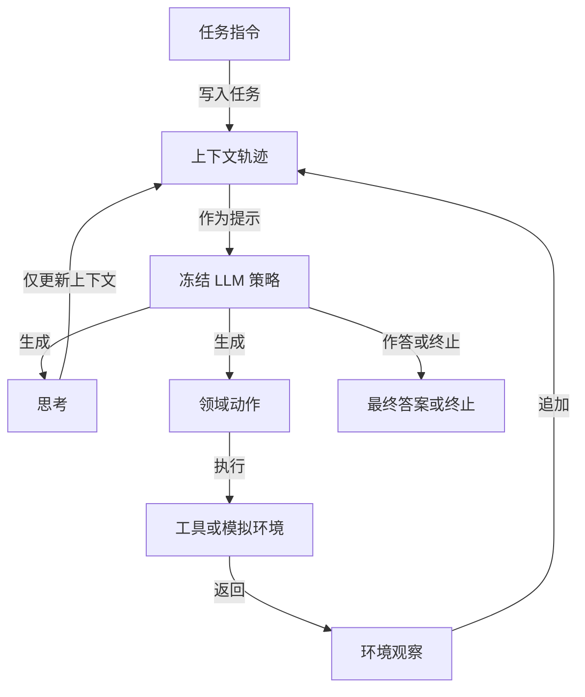
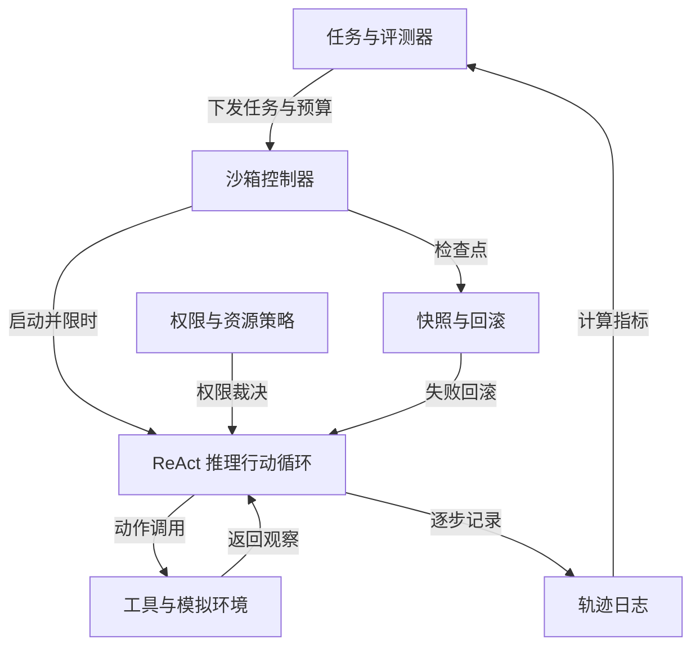
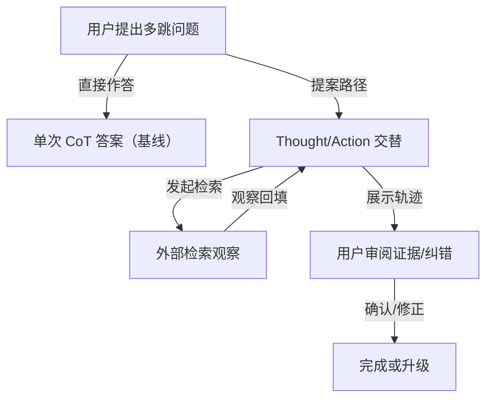
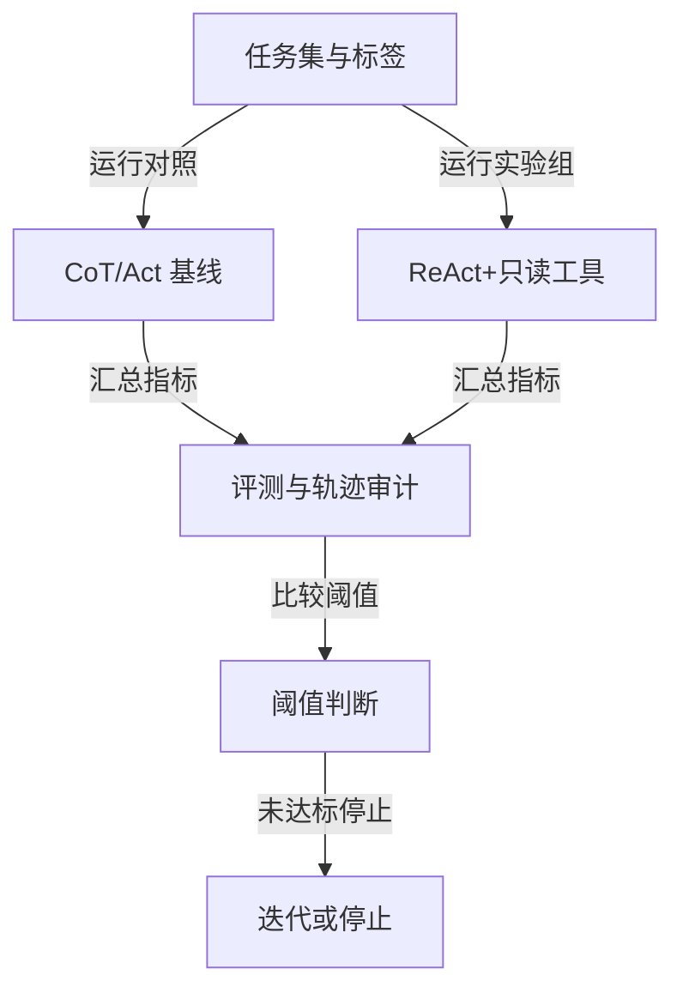

# ReAct 图文报告节选（0.2.3）

来源：https://arxiv.org/abs/2210.03629v3

以下为实际生成的图示节选，分析抽样 2/9 文本片段。产品方案尚未验证；程序生成图形，并非论文作者原图。完整原文引文与定位保存在本地报告。

## ReAct 的交错推理—行动循环

类型：论文事实概括

依据抽取文本与附录示例抽象：思考仅更新上下文，动作进入工具或环境并返回观察；完整提示模板、全部实验流程与统计未覆盖。

对应本地证据编号：P1.F1、P1.F4、P1.F5

## ReAct 研究/评测的沙箱集成框架（提案）

类型：待验证方案

ReAct 证据支持思考—动作—观察循环及任务/工具类型；权限裁决、资源预算、快照与评测组件为待验证的沙箱设计假设，不是论文原有架构。

对应本地证据编号：P1.F1、P1.F2、P1.F3、P1.F6

## ReAct 多跳任务的体验前后对比（提案）

类型：待验证方案

P1/P9 仅支持交错轨迹与示例性失败模式；“用户审阅/纠错”和指标均为设计假设，需用户实验验证。

对应本地证据编号：P1.F1、P1.F2、P9.F3、P9.F5

## ReAct 沙箱 PoC 的验证与停止流程（提案）

类型：待验证方案

论文支持方法对比与基准增益，不支持具体阈值或沙箱架构；流程、指标和停止条件均为待验证设计。

对应本地证据编号：P1.F3、P1.F5、P1.F6
