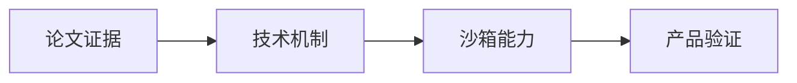
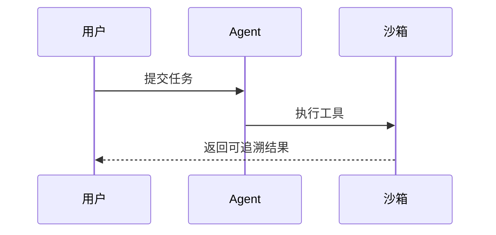
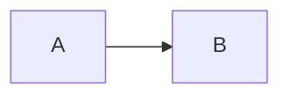

# 报告渲染验收夹具

> 本文仅用于界面测试，不是论文研究结论。

## 技术理解

**核心思想**：把论文中的证据与产品假设分开，见原文定位 [P1.F1](#p1-f1)。

- 已验证：来源可追溯。
- 待验证：产品价值需要实验确认。

| 维度 | 评价指标 | 状态 |
| --- | --- | --- |
| 启动效率 | P95 启动耗时 | 待实验 |
| 稳定性 | 任务成功率 | 待实验 |

行内公式 $E = mc^2$，展示公式：

$$
L(\theta) = -\sum_{i=1}^{n} \log p_\theta(y_i \mid x_i)
$$

```javascript
const value = "<script>unsafe()</script>";
console.log(value);
```

## 研究关系图





## 安全降级

以下图表故意包含错误，应该显示源码和原因，正文仍可阅读。

```mermaid
this is deliberately invalid Mermaid
```



<script>document.title="UNSAFE-REPORT"</script>

[危险链接](javascript:alert(1))

## 原文证据

### P1-F1

测试段落，章节跳转应定位到这里。这个夹具不引述真实论文。

## 原文证据

同名标题应获得独立的跳转目标。
